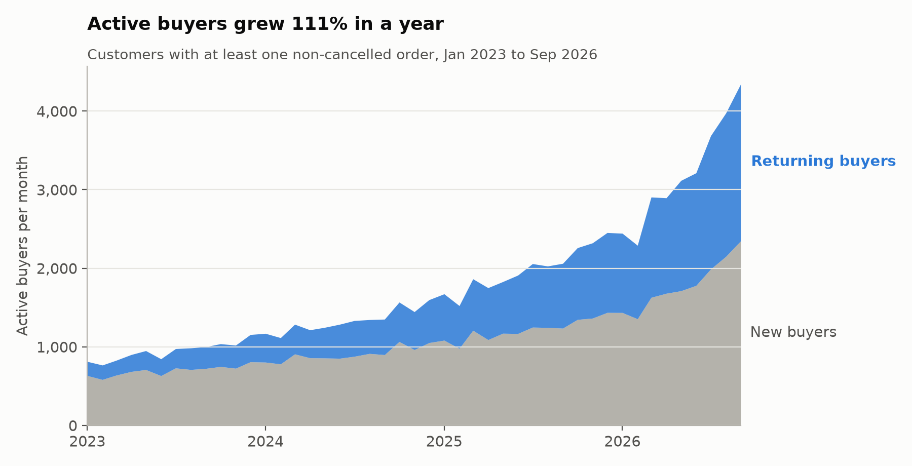
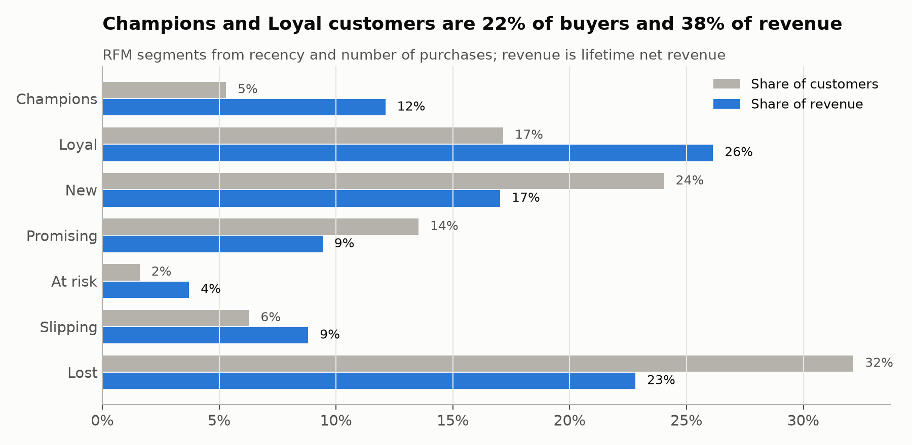
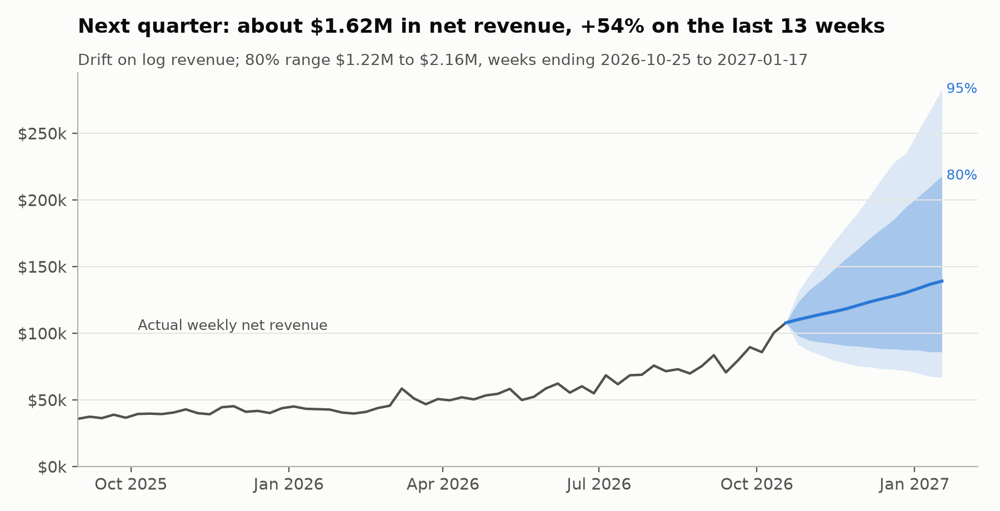
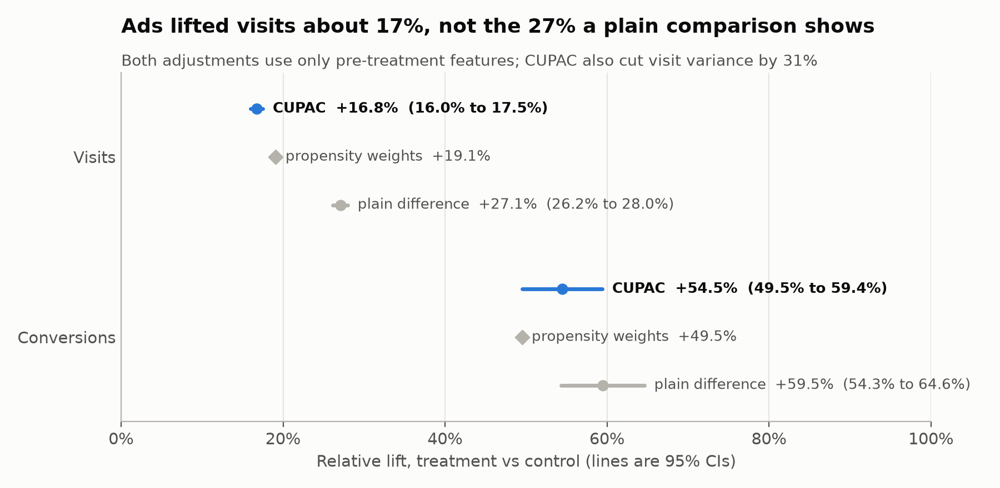
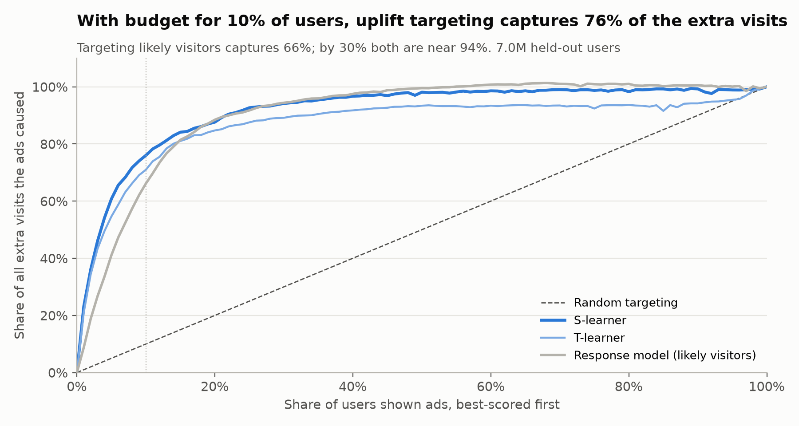

# E-commerce product analytics

Analytics for an online clothing store, built the way a product analytics team would: raw data pulled from BigQuery, modeled and tested in dbt, then analyzed in Python. The question running through it: where does the store lose customers, and what actually brings them back?

**[Live dashboard](https://apushp.github.io/ecommerce-product-analytics/)** · **[Decision memo](reports/decision_memo.md)**

The project covers a dbt warehouse with tests, a North Star metric and revenue drivers, funnel and channel tests, survival analysis and cohorts, RFM segments and lifetime value, A/B testing with variance reduction, uplift modeling, and revenue forecasting with backtested intervals.

## What I found so far



- **Active buyers grew 111% in a year** (2,061 in Sep 2025 to 4,351 in Sep 2026). That alone explains 99% of revenue growth. Order value stayed flat at about $84 to $88, and orders per buyer barely moved.
- **The cart is the biggest leak.** 63% of sessions add something to cart, but only 41% of those carts become orders.
- **No traffic channel converts better than another.** Chi-square p = 0.76, Cramér's V = 0.0017.
- **25% of customers order again within a year** (Kaplan-Meier, which accounts for recent customers who haven't had time to come back). The simple "2+ orders" rate says 37%, and that number mixes long-time customers with brand new ones.
- **Repeat buying is rising store-wide**, from 1.7% to 2.8% of customers ordering again each month over the past year. It shows up along the diagonals of the cohort table, not down its columns.

## Customer segments and lifetime value



- **RFM segments.** Every customer is scored on recency (quintiles), number of purchases and spend, then named. Champions and Loyal customers are 22% of buyers and 38% of revenue. Lost customers (one purchase, long ago) are the biggest group at 32%.
- **k-means agrees only loosely.** The best k by silhouette is 2, which just splits one-time buyers from repeat buyers (adjusted Rand index 0.28 against the named segments). Clustering finds the structure that's in the numbers; the named segments add the recency cut that a retention campaign needs.
- **Lifetime value.** I wrote BG/NBD (how many more purchases) and Gamma-Gamma (what each is worth) with scipy and fitted them by maximum likelihood. A Champion is worth about $34 over the next year and a Lost customer about $9.
- **The model ran 35% low on a 26-week holdout.** It predicted 3,920 purchases and customers made 5,989. BG/NBD assumes each customer's buying rate stays put, but stage 3 showed repeat buying rising across the store. On top of that, past buying barely predicts future buying here: the top 10% of customers by predicted purchases made only 16.5% of the holdout purchases, where 10% would be random. I treat CLV as a rough guide on this dataset, not a forecast.
- thelook caps customers at 4 orders, so nobody with 4 purchases ever buys again. The holdout check is what showed this.

## Revenue forecast



- **Next quarter: about $1.62M in net revenue** (weeks ending 2026-10-25 to 2027-01-17), 54% more than the last 13 weeks. The 80% range is $1.22M to $2.16M.
- **Four models, one backtest.** Naive, drift, damped-trend ETS and ARIMA(1,1,1) with drift, all on log revenue because the store grows by a percentage each week. Each forecast 13 weeks ahead from 8 starting weeks over the past year. Drift was most accurate (9.0% average error, against 11.5% to 13.3% for the others).
- **The intervals mattered more than the point forecasts.** ETS's and ARIMA's 80% intervals held the actual revenue only 44% and 41% of the time. Their intervals only cover the week-to-week noise they saw, not the growth rate changing underneath them. Drift's intervals were too wide instead (95% coverage at 80%), which is the safer mistake for planning.
- **Every model ran low,** drift by 6% on average, because growth kept speeding up through 2026. If that continues, the real quarter lands in the upper half of the range.
- No weekly or yearly seasonality showed up (every weekday and month looks the same), which fits a generated dataset.

## A/B test: did Criteo's ads work?



Criteo held back 15% of 14M users from an ad campaign. I read the test the way an experimentation team would, checking the setup before looking at the result.

- **The split checks out, but the groups aren't quite comparable.** Treatment is 85.000% of users, exactly as designed, so the sample ratio mismatch check passes. Every pre-treatment feature also passes the usual 0.1 standardized-difference rule. But the biggest gap is 65 times what random assignment would produce. The file turns out to be long runs of treated rows and long runs of control rows with different base visit rates, so the control group isn't drawn from the same mix of users.
- **Ads lifted visits by about 17%, not the 27% a plain comparison shows.** Two independent adjustments that only use pre-treatment features agree: CUPAC (predict each user's outcome, then regress it out) gives +16.8% (95% CI 16.0% to 17.5%), and inverse propensity weighting gives +19.1%. Conversions rose about 50 to 55%. CUPAC also cut the variance of the visit estimate by 31%, which is like running the test on 44% more users.
- **The 85/15 split was expensive.** It needs 1.96x the users of a 50/50 test for the same precision. Even so, 14M users could detect a 1.1% lift in visits.
- **Peeking breaks the 5% promise.** In 1,000 A/A tests (control split against itself), 4% came out significant when checked once. Checking 20 times and stopping at the first p < 0.05 gave a false win 26% of the time.
- **Only 3.6% of the treatment group actually saw an ad.** Comparing users who saw one with users who didn't suggests a 38-point jump in visit rate. Using random assignment as an instrument, the real effect of seeing the ad is 17.8 points. The people who got shown ads would have visited 24% of the time anyway, against 3.8% for an average user.

## Uplift: who should see an ad?



The average effect hides who the ads actually move. I trained models on 4M users to predict how much an ad changes each person's chance of visiting, then scored 7M users they never saw.

- **The effect is packed into a few users.** The top 10% by predicted uplift hold 76% of all the extra visits the ads caused, and their visit rate rises 5.8 points. The bottom half gains 0.04 points.
- **Uplift targeting wins when the budget is tight.** Showing ads to the top 10% by uplift captures 76% of the extra visits, against 66% when targeting users most likely to visit (a 10-point gain, bootstrap 95% CI 7 to 13). From 30% of users up, both approaches capture about 94%, because in this data the people ads move are mostly people already likely to visit.
- **The S-learner beat the T-learner.** The control group is only 15% of users, so the T-learner's separate control model had less to learn from and came out noisier.
- Every comparison is weighted by inverse propensity, carrying over the stage 5 fix for the groups not being perfectly comparable.

More charts are in [`reports/figures/`](reports/figures/). Every number above is in the `reports/stage*_numbers.json` files.

## Data

| Dataset | What it is | Used for |
| --- | --- | --- |
| [thelook_ecommerce](https://console.cloud.google.com/marketplace/product/bigquery-public-data/thelook-ecommerce) | Google's public BigQuery dataset of a fictional clothing store: 97k users, 120k orders, 2.4M web events | warehouse, metrics, funnel, cohorts, segments, lifetime value |
| [Criteo Uplift v2.1](https://huggingface.co/datasets/criteo/criteo-uplift) | a real randomized ad experiment, about 14M users | A/B testing and uplift modeling |

thelook is synthetic, so some patterns are generator artifacts rather than real behavior. Anonymous sessions never buy, and every channel converts at the same rate. I kept these as documented limitations. The A/B testing uses Criteo's real experiment for this reason.

Data is cut off at **2026-10-22**. thelook's daily refresh piles about 13x the normal number of signups into the last week before a pull. Left in, it looks like sales tripled overnight.

## How it's built

```
BigQuery (public data)
   └─ scripts/01_extract_thelook.py   pull 7 tables once, save as parquet
        └─ dbt on DuckDB              staging → intermediate → marts, 54 tests
             └─ scripts/02_...py      metrics, funnel, stats tests, charts
             └─ scripts/05_...py      RFM segments, k-means, BG/NBD + Gamma-Gamma CLV
             └─ scripts/06_...py      weekly revenue forecast, rolling backtest
                  └─ scripts/07_...py dashboard page in docs/ (GitHub Pages)

Criteo csv (Hugging Face)
   └─ scripts/03_ab_test_criteo.py    SRM, balance, power, lift, CUPAC, A/A, exposure
        └─ scripts/04_uplift_criteo.py    S/T-learners, Qini curves, bootstrap
```

- `dbt/models/staging/`: one cleaned model per raw table. Timestamps go to UTC, personal data is dropped, and the date cutoff is applied.
- `dbt/models/marts/`: `fct_sessions`, `fct_orders`, `fct_order_items`, `dim_users`, `dim_products`, `mart_monthly_kpis`, `mart_cohort_retention`, `mart_customer_rfm`.
- Revenue rules are defined once in `fct_order_items`: gross revenue excludes cancelled items, and net revenue also excludes returns.
- Two business-rule tests check that order revenue matches item revenue, and that net revenue is never above gross.

## Run it

```bash
python3 -m venv .venv && source .venv/bin/activate
pip install -r requirements.txt

gcloud auth application-default login
python scripts/01_extract_thelook.py --project <your-gcp-project>

cd dbt && dbt build --profiles-dir . && cd ..
python scripts/02_metrics_funnel_retention.py
python scripts/05_segments_clv.py
python scripts/06_forecast_revenue.py

# Criteo: download criteo-uplift-v2.1.csv.gz from Hugging Face into data/raw/
python scripts/03_ab_test_criteo.py   # about 2 minutes, needs ~4GB of memory
python scripts/04_uplift_criteo.py    # about 5 minutes

# dashboard, after everything above
python scripts/07_build_dashboard.py
```

The BigQuery sandbox is free, and no credit card is needed. Reading the tables uses `list_rows`, which doesn't count against the query quota.
