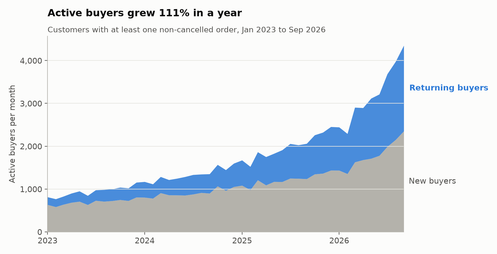

# E-commerce product analytics

Analytics for an online clothing store, built the way a product analytics team would: raw data pulled from BigQuery, modeled and tested in dbt, then analyzed in Python. The question running through it: where does the store lose customers, and what actually brings them back?

**Work in progress.** Stages 1 to 3 are done. A/B testing, uplift modeling, segmentation, forecasting and a dashboard come next.

## What I found so far



- **Active buyers grew 111% in a year** (2,061 in Sep 2025 to 4,351 in Sep 2026). That alone explains 99% of revenue growth. Order value stayed flat at about $84 to $88, and orders per buyer barely moved.
- **The cart is the biggest leak.** 63% of sessions add something to cart, but only 41% of those carts become orders.
- **No traffic channel converts better than another.** Chi-square p = 0.76, Cramér's V = 0.0017.
- **25% of customers order again within a year** (Kaplan-Meier, which accounts for recent customers who haven't had time to come back). The simple "2+ orders" rate says 37%, and that number mixes long-time customers with brand new ones.
- **Repeat buying is rising store-wide**, from 1.7% to 2.8% of customers ordering again each month over the past year. It shows up along the diagonals of the cohort table, not down its columns.

More charts are in [`reports/figures/`](reports/figures/), and every number above is in [`reports/stage3_numbers.json`](reports/stage3_numbers.json).

## Data

| Dataset | What it is | Used for |
| --- | --- | --- |
| [thelook_ecommerce](https://console.cloud.google.com/marketplace/product/bigquery-public-data/thelook-ecommerce) | Google's public BigQuery dataset of a fictional clothing store: 97k users, 120k orders, 2.4M web events | warehouse, metrics, funnel, cohorts |
| [Criteo Uplift v2.1](https://huggingface.co/datasets/criteo/criteo-uplift) | a real randomized ad experiment, about 14M users | A/B testing and uplift (next stage) |

thelook is synthetic, so some patterns are generator artifacts rather than real behavior. Anonymous sessions never buy, and every channel converts at the same rate. I kept these as documented limitations. The A/B testing uses Criteo's real experiment for this reason.

Data is cut off at **2026-10-22**. thelook's daily refresh piles about 13x the normal number of signups into the last week before a pull. Left in, it looks like sales tripled overnight.

## How it's built

```
BigQuery (public data)
   └─ scripts/01_extract_thelook.py   pull 7 tables once, save as parquet
        └─ dbt on DuckDB              staging → intermediate → marts, 49 tests
             └─ scripts/02_...py      metrics, funnel, stats tests, charts
```

- `dbt/models/staging/`: one cleaned model per raw table. Timestamps go to UTC, personal data is dropped, and the date cutoff is applied.
- `dbt/models/marts/`: `fct_sessions`, `fct_orders`, `fct_order_items`, `dim_users`, `dim_products`, `mart_monthly_kpis`, `mart_cohort_retention`.
- Revenue rules are defined once in `fct_order_items`: gross revenue excludes cancelled items, and net revenue also excludes returns.
- Two business-rule tests check that order revenue matches item revenue, and that net revenue is never above gross.

## Run it

```bash
python3 -m venv .venv && source .venv/bin/activate
pip install -r requirements.txt

gcloud auth application-default login
python scripts/01_extract_thelook.py --project <your-gcp-project>

cd dbt && dbt build --profiles-dir . && cd ..
python scripts/02_metrics_funnel_retention.py
```

The BigQuery sandbox is free, and no credit card is needed. Reading the tables uses `list_rows`, which doesn't count against the query quota.
